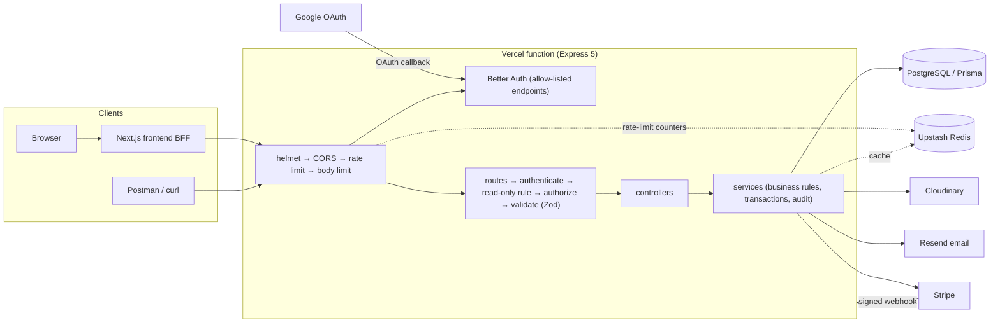
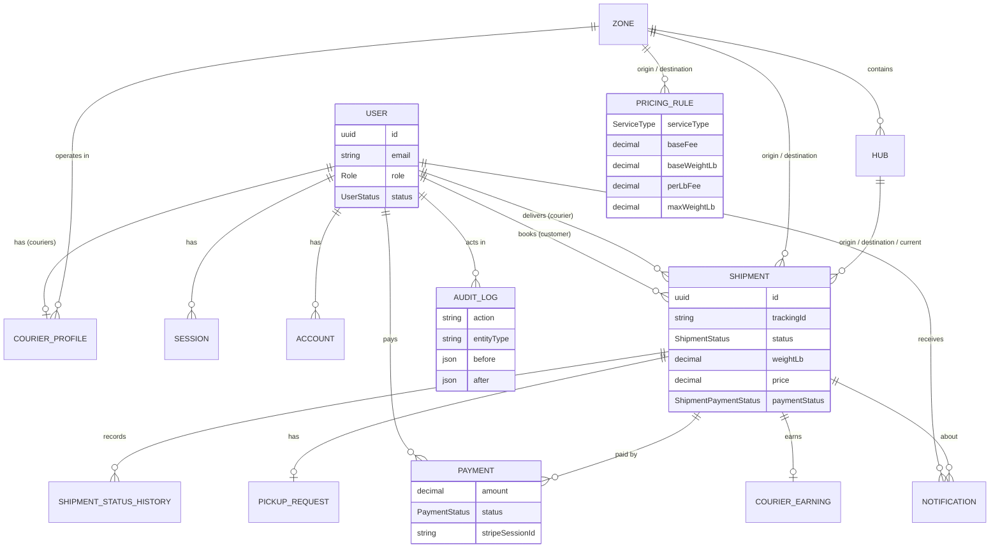
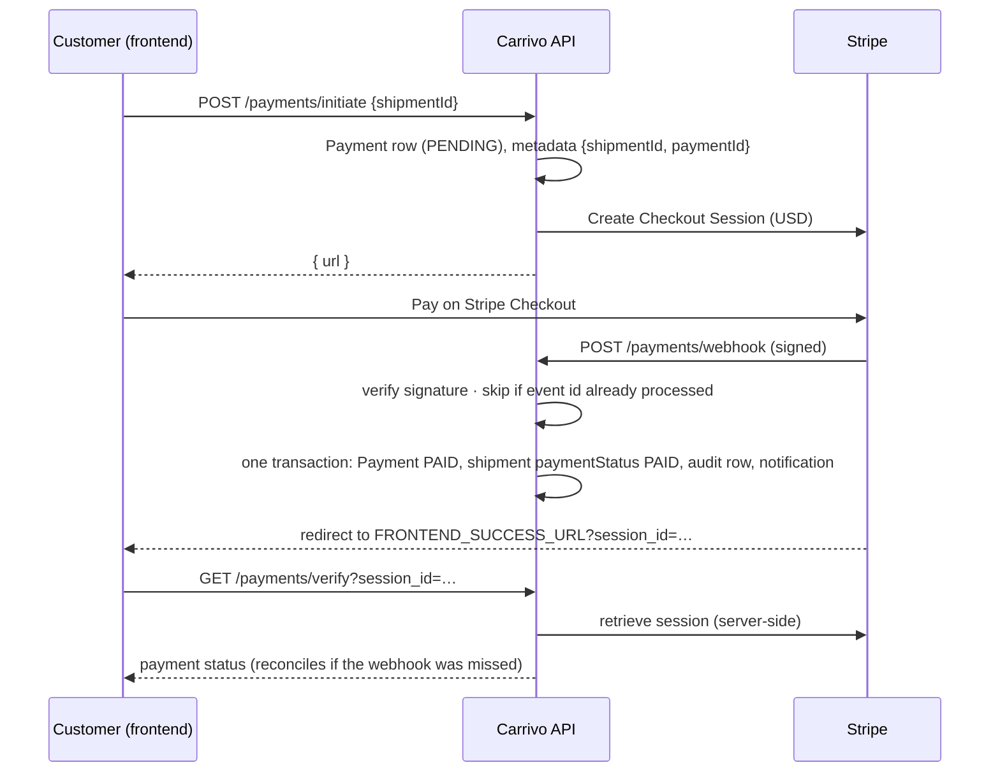
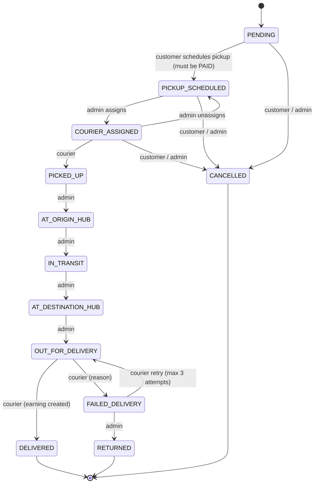

# Carrivo API

REST API for **Carrivo**, a US courier and logistics platform. Customers book, pay for and track parcels; couriers pick them up and deliver them; admins run zones, hubs, pricing, assignments, payments, users and reports. A read-only **Admin Viewer** can see everything an admin sees and change nothing.

```
Live API      : <https://your-api.example.com>
API docs      : <link to the published Postman documentation>
Frontend      : <https://your-frontend.example.com>
Repository    : <https://github.com/your-account/carrivo-backend>
Demo video    : <link>
```

Demo account emails are listed in [Seed and reset](#seed-and-reset). Passwords are never written in this repository.

## Contents

1. [Features by role](#features-by-role)
2. [Architecture](#architecture)
3. [Tech stack](#tech-stack)
4. [Folder structure](#folder-structure)
5. [Data model](#data-model)
6. [API conventions](#api-conventions)
7. [Endpoints](#endpoints)
8. [Auth model](#auth-model)
9. [Payments](#payments)
10. [Shipment state machine](#shipment-state-machine)
11. [Rate limiting](#rate-limiting)
12. [Caching](#caching)
13. [Security](#security)
14. [Testing](#testing)
15. [Scripts](#scripts)
16. [Local setup](#local-setup)
17. [Environment variables](#environment-variables)
18. [Deployment (Vercel)](#deployment-vercel)
19. [Seed and reset](#seed-and-reset)
20. [Roadmap](#roadmap)

## Features by role

US conventions everywhere: prices in **USD**, weights in **pounds** (`weightLb`), addresses as `street, City, ST 12345` (ZIP or ZIP+4, validated state code), US phone numbers, and business dates in **America/New_York** (DST-aware).

**Customer**
- Sign up with email/password or Google; always created as `CUSTOMER`.
- Live price quote (zone pair, service type, weight) before booking; the server prices every shipment itself.
- Create, edit (before payment), cancel (before pickup, refunded if paid) and list own shipments.
- Pay with Stripe Checkout; schedule a pickup window once paid.
- Public tracking timeline by tracking id (no personal data).
- Payment history, in-app notifications and lifecycle emails, own profile.

**Courier**
- Assigned tasks with search and filters; only the next allowed status (picked up, delivered, failed with a reason, retry up to 3 attempts).
- Proof-of-delivery photo upload (Cloudinary, 4 MB max, type-checked).
- Earnings with summary; availability on/off.

**Admin**
- Dashboard stats (totals, statuses, revenue, top couriers) and the full audit log.
- All shipments: assign / unassign couriers (concurrency-safe), hub legs, returns, cancel, soft delete.
- Zones, hubs and pricing rules (create, update, soft delete).
- Users: create couriers and admins, change role, activate / deactivate (revokes sessions).
- Payments: list, refund retry.

**Admin Viewer** (`ADMIN_VIEWER`)
- Every admin **GET** route: dashboard stats, users, shipments, payments, audit logs, zones, hubs, pricing rules, couriers.
- **Every write is refused** with `403 "This account is read-only"`, including its own profile and password. Only `POST /auth/logout` and `POST /auth/refresh-token` are allowed.
- Not allowed on customer- or courier-only routes, and not on `GET /payments/verify` (it can write).
- Created only by the seed. Registration, Google sign-in and `PATCH /admin/users/:id/role` can never grant `ADMIN_VIEWER` (or, for sign-up, `ADMIN`).

## Architecture



**Request flow.** Each request passes the same pipeline, in this order:

1. `helmet` headers, then CORS (allow-list).
2. Stripe webhook route (raw body, signature check). It sits before the JSON parser and the per-IP limiter.
3. Global rate limiter (per visitor, Redis-backed).
4. Auth routes: our wrappers (register, login, logout, refresh-token, Google), then an allow-list of Better Auth endpoints behind a body-size guard and the read-only guard.
5. `express.json` (100 KB limit), then `/api/v1/<module>`.
6. Each route: `authenticate` (session, active user, **read-only rule**), `authorize(...roles)`, `validateRequest(zod)`, a thin controller, then the service.
7. Services hold all business logic and all Prisma access. Multi-row changes run in `prisma.$transaction` and write the status history and audit rows in the same transaction.
8. Errors anywhere go to one global handler, which returns the error envelope. Unknown routes get a 404 envelope.

## Tech stack

| Area | Choice | Why |
|---|---|---|
| Language | TypeScript (strict, no `any`), ES modules, Node.js ≥ 22.12 | Types shared from the Prisma schema to responses; strictness catches contract drift |
| HTTP | Express 5 | Small, well understood, async errors handled natively |
| Database | PostgreSQL + Prisma 7 (`@prisma/adapter-pg`) | Relational data with transactions and row locks; typed queries and migrations |
| Validation | Zod 4 | One schema validates body, query and params, and produces typed input |
| Auth | Better Auth (email/password, Google, `bearer` plugin) | Maintained password hashing, sessions and OAuth; bearer tokens suit a separate frontend |
| Payments | Stripe Checkout + signed webhooks (test mode) | Card data never touches the API; the webhook is the source of truth |
| Cache and rate limits | Upstash Redis (REST) | Works from serverless functions (no long-lived TCP); shared limits across instances |
| Files | Multer (memory) + Cloudinary | No disk on serverless; signed server uploads |
| Email | Resend | Simple HTTP API; email failure never fails a request |
| Security | helmet, cors, express-rate-limit | Standard, audited middleware |
| Hosting | Vercel serverless (`api/index.ts`) | One function for the whole app; preview deploys per branch |
| Tests | `node:test` + `tsx` | No extra test framework; tests run against the real route table |

## Folder structure

```
api/index.ts                 Vercel entry: export default app
src/
  app.ts                     Express app: middleware order, webhook, auth, routes, errors
  server.ts                  local listener
  app/
    config/                  env (Zod-validated), roles, currency, frontend paths
    lib/                     prisma, auth (Better Auth), stripe, redis, cache, cloudinary, email
    middlewares/             authenticate, readOnly, authorize, validateRequest, rate limiters, upload, errors
    modules/<name>/          route · controller · service · validation · types (+ utils, tests)
                             auth user zone hub pricing shipment tracking courier payment admin audit notification health
    routes/index.ts          module mount table (flat, so tests can walk every route)
    utils/                   sendResponse, catchAsync, ApiError, pagination, money, timezone, US validation
    errors/                  Zod and Prisma error mappers
  generated/prisma/          generated client (git-ignored)
prisma/
  schema.prisma, migrations/ schema and SQL migrations
  seed.ts, seed.safety.ts    idempotent US demo seed and its guards
  reset-demo.ts, reset.safety.ts   guarded demo-data reset and its guards
scripts/                     smoke test and dev-only helpers (never deployed)
docs/                        Postman collection, deployment guide
```

## Data model

All domain ids are UUID v7. Money is `Decimal(10,2)`, returned as a string (`"6.00"`). Weights are `Decimal(8,2)` pounds. Mutable entities are soft-deleted (`deletedAt`), and every read excludes deleted rows.



`STRIPE_EVENT` (processed webhook ids) and Better Auth's `VERIFICATION` table stand alone. Indexes cover the filtered and sorted columns: status, payment status, customer/courier + date, zones, service type, `createdAt`, `deletedAt`, the unique tracking id, Stripe ids, audit entity/action/date and notification user + read state.

**Pricing:** `price = baseFee + ceil(max(0, weightLb − baseWeightLb)) × perLbFee`. A zone-pair rule wins over the service type's default rule; above `maxWeightLb` the quote is refused (422).

## API conventions

- Base path `/api/v1`. JSON in and out (proof upload is multipart).
- **Success:** `{ "success": true, "message": "...", "data": ..., "meta"?: { "page", "limit", "total", "totalPages" } }`
- **Error:** `{ "success": false, "message": "...", "errors": [ { "path": "body.weightLb", "message": "..." } ] }`
- **Lists** accept `page`, `limit` (max 100), `sortBy`, `sortOrder` (`asc`/`desc`), `searchTerm` and module filters, and return `meta`.
- **Dates** in queries: `YYYY-MM-DD` means that calendar day in America/New_York; full ISO timestamps are also accepted.
- **Status codes:** 200/201 success · 400 validation · 401 missing or invalid token · 403 wrong role or read-only account · 404 not found **or not yours** (existence is not revealed) · 409 conflict (state machine, duplicates) · 413/415 upload · 422 business rule (e.g. no price for that route) · 429 rate limit.
- Every POST, PATCH and PUT is validated with Zod. The Stripe webhook is the one exception; its signature is verified instead.

## Endpoints

64 endpoints: 58 of ours plus 6 allow-listed Better Auth endpoints. "Auth" = any signed-in role. "Staff" = ADMIN and ADMIN_VIEWER (reads only). The Postman collection has an example request and response for each.

| Method | Path | Role | Purpose |
|---|---|---|---|
| GET | `/health` | Public | Liveness + database check |
| POST | `/auth/register` | Public | Sign up (always CUSTOMER), returns token |
| POST | `/auth/login` | Public | Login, returns bearer token |
| POST | `/auth/logout` | Auth | Revoke the current session |
| POST | `/auth/refresh-token` | Auth | Rotate the session (old token revoked) |
| GET | `/auth/google?challenge=` | Public | Start Google sign-in (302) |
| GET | `/auth/google/complete` | Browser | Landing after Google; 302 to the frontend with a one-time code |
| POST | `/auth/google/exchange` | Public | One-time code + verifier → token |
| POST | `/auth/change-password` | Auth (not viewer) | Better Auth: change password |
| GET | `/auth/get-session` | Auth | Better Auth: current session |
| POST | `/auth/revoke-sessions`, `/auth/revoke-other-sessions` | Auth (not viewer) | Better Auth: sign out everywhere / other devices |
| GET | `/auth/ok`, `/auth/callback/google` | Public | Better Auth health / Google redirect URI |
| GET, PATCH | `/users/me` | Auth (PATCH not viewer) | Own profile |
| GET | `/zones`, `/zones/:id`, `/hubs`, `/hubs/:id` | Public | Zones and hubs (cached) |
| POST, PATCH, DELETE | `/zones…`, `/hubs…` | Admin | Manage zones and hubs (delete refused while in use) |
| POST | `/pricing/estimate` | Public | Price quote |
| GET | `/pricing`, `/pricing/:id` | Staff | Pricing rules |
| POST, PATCH, DELETE | `/pricing…` | Admin | Manage pricing rules |
| POST | `/shipments` | Customer | Create (server-priced, tracking id) |
| GET | `/shipments`, `/shipments/:id` | Auth | Customer: own · courier: assigned · staff: all |
| PATCH | `/shipments/:id` | Customer | Edit own before payment (re-priced) |
| POST | `/shipments/:id/cancel` | Customer, Admin | Cancel before pickup (refund if paid) |
| DELETE | `/shipments/:id` | Admin | Soft delete (PENDING or terminal) |
| POST | `/shipments/:id/pickup` | Customer | Schedule pickup window (requires PAID) |
| POST | `/shipments/:id/assign`, `/unassign` | Admin | Courier assignment |
| PATCH | `/shipments/:id/status` | Courier, Admin | Status change through the state machine |
| POST | `/shipments/:id/proof` | Courier | Proof-of-delivery photo (multipart, ≤ 4 MB) |
| GET | `/tracking/:trackingId` | Public | Public timeline (cached 15 s) |
| GET | `/couriers` | Staff | Couriers for assignment |
| GET | `/couriers/me/tasks`, `/couriers/me/earnings` | Courier | Own tasks and earnings |
| PATCH | `/couriers/me/availability` | Courier | Availability |
| GET | `/admin/users`, `/admin/dashboard-stats`, `/admin/audit-logs`, `/admin/payments` | Staff | Admin reads |
| POST | `/admin/users` | Admin | Create a courier or admin |
| PATCH | `/admin/users/:id/role`, `/admin/users/:id/status` | Admin | Change role (CUSTOMER, COURIER, ADMIN only) / activate–deactivate |
| POST | `/admin/payments/:id/refund` | Admin | Retry or complete a refund |
| POST | `/payments/initiate` | Customer | Payment row + Stripe Checkout Session URL |
| GET | `/payments/verify?session_id=` | Customer, Admin | Success-page reconciliation (server-side Stripe lookup) |
| GET | `/payments/my` | Customer | Own payments |
| GET | `/payments/:id` | Customer (own), Staff | Payment detail |
| POST | `/payments/webhook` | Stripe | Signed webhook (raw body, idempotent) |
| GET | `/notifications/my` | Auth | Own notifications |
| PATCH | `/notifications/read-all`, `/notifications/:id/read` | Auth (not viewer) | Mark read |

## Auth model

- **Better Auth** owns password hashing, sessions and Google OAuth. Only an allow-list of its endpoints is reachable over HTTP (`BETTER_AUTH_ALLOWED_PATHS` in `src/app/lib/auth.ts`); endpoints that return raw tokens (e.g. `list-sessions`) or act as a password oracle are not exposed.
- **Bearer tokens:** every protected route takes `Authorization: Bearer <token>`. Tokens last 7 days; `/auth/refresh-token` rotates a still-valid token and revokes the old one; `/auth/logout` revokes it. Deactivated users can't log in, refresh or use existing tokens.
- **Roles:** `CUSTOMER`, `COURIER`, `ADMIN`, `ADMIN_VIEWER`. `role` is a Better Auth field with `input: false` and a `user.create.before` hook that forces `CUSTOMER` for every sign-up path, including Google. Staff roles are created by the seed (viewer) or by an admin (`POST /admin/users`: COURIER or ADMIN).
- **Guards:** `authenticate` (session, active account, read-only rule) → `authorize(...roles)` → ownership checks in services.
- **Read-only rule:** one central check, `violatesReadOnly(role, method, url)` in `src/app/middlewares/readOnly.ts`, keyed on the HTTP method and role. It runs inside `authenticate` (so every protected route gets it) and in front of Better Auth's own handler. New routes are covered automatically; a test walks the real route table to prove it.
- **Google sign-in (PKCE one-time-code handoff):** no token ever appears in a URL.
  1. The frontend creates a random `codeVerifier` and opens `GET /auth/google?challenge=<base64url(SHA-256(verifier))>`.
  2. After Google, the API redirects to `FRONTEND_URL/auth/google/callback?code=<one-time code>` (or `?error=account_exists | account_deactivated | google_cancelled | google_failed`).
  3. The frontend posts `{ code, codeVerifier }` to `/auth/google/exchange` within 60 seconds; the code works once and returns the same `{ token, expiresAt, user }` as login.
  4. Google sign-in never links to an existing email/password account.

## Payments



- A payment is never marked paid from client input: only the verified webhook or the server-side session lookup can do it.
- **Idempotency:** processed Stripe event ids are stored (`stripe_events`); already-PAID payments are ignored.
- **Refunds:** cancelling a paid shipment before pickup creates a Stripe refund; `charge.refunded` / `refund.failed` update it, and admins can retry a pending refund.
- Handled events: `checkout.session.completed`, `checkout.session.async_payment_succeeded`, `checkout.session.async_payment_failed`, `checkout.session.expired`, `payment_intent.payment_failed`, `charge.refunded`, `refund.failed`.

## Shipment state machine

One transition table (`TRANSITIONS` in `src/app/modules/shipment/shipment.constants.ts`) lists the roles allowed for each move, and every change goes through one service function. In one transaction it checks the move, the actor's role and ownership, updates the shipment, and writes a status-history row and an audit row; notifications go out after the commit.



Courier assignment re-checks availability and zone inside the transaction with row locks, so two concurrent requests can't double-assign a courier.

## Rate limiting

| Limiter | Scope | Limit |
|---|---|---|
| Global | every route except the Stripe webhook | 300 requests / 15 min per visitor |
| Auth | login, register, change-password | 20 **failed** attempts / 15 min per visitor |

- Counters live in Redis (shared by all serverless instances); without Redis they fall back to memory.
- The key is the connecting IP (`trust proxy` set for Vercel). When the frontend's server sends `x-bff-secret` matching `BFF_SHARED_SECRET` (constant-time compare) and a valid `x-client-ip`, that IP is used instead, so visitors behind the BFF don't share one bucket. A browser can't choose its own key.
- 429 responses use the error envelope and standard `RateLimit` headers.

## Caching

Only responses that are identical for every caller are cached (Redis, `REDIS_KEY_PREFIX` per environment):

| Data | TTL | Invalidated by |
|---|---|---|
| Zones, hubs (lists and details) | 120 s | any zone/hub write |
| Price estimates | 120 s | zone or pricing writes |
| Public tracking | 15 s | expiry |
| Admin dashboard stats | 60 s | expiry |

Role-scoped data (shipments, payments, users) is never cached. A Redis error is logged and the request falls through to the database.

## Security

**What is protected and how**

- **HTTP hardening:** `helmet` headers, `x-powered-by` off, 100 KB JSON limit, 4 MB upload limit with type checks.
- **CORS allow-list:** only origins in `CORS_ORIGINS`; other browser origins get 403.
- **Rate limits:** see [Rate limiting](#rate-limiting); stricter on authentication.
- **Input validation:** Zod on every body, query and params; US address, phone and ZIP formats; unknown keys are rejected where it matters (e.g. `role` on sign-up).
- **Role guards:** `authenticate` + `authorize` on every protected route, ownership checks in services (other users' records answer 404), and the central read-only rule for `ADMIN_VIEWER`. Tests walk the real route table to check them.
- **Account safety:** role is never client-settable; deactivation revokes sessions; Better Auth endpoints are allow-listed.
- **Secret handling:** secrets come only from environment variables, validated at startup (error messages list names, never values). Responses never include password hashes, session tokens or provider secrets; audit snapshots are redacted on write and on read.
- **Webhook verification:** Stripe signatures are checked over the raw request body before anything is read; events are processed once.
- **No secrets in logs:** only unexpected (5xx) errors are logged, as the error itself, never the request headers or body; responses never include stack traces. Seed and reset scripts print hosts and emails only.
- **Production scripts:** seeding and resetting refuse to run unless the operator confirms the database host (and, for reset, types an exact phrase).

**Responsible disclosure.** If you find a vulnerability, please report it privately to the repository owner (use GitHub's private vulnerability reporting on this repository) instead of opening a public issue. Include steps to reproduce; please don't access other users' data or degrade the service while testing. We aim to reply within a few days.

**Intentionally not documented publicly:** real hostnames of the database, cache and storage services, account and project ids, environment variable values, demo passwords, internal dashboards, and the exact detection thresholds beyond the published rate limits.

## Testing

`npm test` runs 167 unit and HTTP tests with `node:test` (no database or external service needed; Redis is disabled in tests). Highlights:

- **Read-only rule** (`src/app/middlewares/readOnly.test.ts`): walks the real route table; a viewer gets 403 on every mutating route, is allowed on every admin GET, and is refused on customer/courier-only routes. Routes added later are covered automatically.
- **Role escalation** (`src/app/modules/auth/auth.roles.test.ts`): registration and Google exchange reject a `role` field; the Better Auth hook forces `CUSTOMER`.
- Pricing (pounds), the state machine, money, US validation, America/New_York dates (DST), pagination, audit redaction, Stripe helpers, image checks, email sender, notification text, Google PKCE helpers, rate-limit keys, and the seed/reset guards.

Also available: `npm run smoke -- <baseUrl>` (read-only checks against any deployment, about 60 requests) and the Postman collection (`docs/postman_collection.json`) with an **RBAC matrix** folder, including an Admin Viewer section, that asserts exact status codes.

Not covered by automated tests: live Stripe, Google, Cloudinary and Resend calls, and database migrations (run them against a disposable branch first, see [docs/DEPLOYMENT.md](docs/DEPLOYMENT.md)).

## Scripts

| Script | What it does |
|---|---|
| `npm run dev` | Start with reload (tsx watch) |
| `npm run build` / `npm start` | Generate the Prisma client and compile / run the compiled server |
| `npm run typecheck` | `tsc --noEmit` |
| `npm test` | All tests |
| `npm run smoke -- <baseUrl>` | Read-only smoke test |
| `npm run db:migrate` / `db:deploy` | Create a migration (dev) / apply migrations |
| `npm run db:seed` | Idempotent US demo seed |
| `npm run db:reset-demo` | Guarded reset of demo data, then reseed |
| `npm run db:studio` | Prisma Studio |
| `npm run dev:mark-paid -- <trackingId>` | Dev only: mark a shipment paid without Stripe (refuses in production and on Vercel) |

## Local setup

Requires Node.js ≥ 22.12, npm, a PostgreSQL database (local or a cloud dev branch), and optionally the Stripe CLI.

```bash
npm install                 # also runs prisma generate
cp .env.example .env        # fill in your own values
npm run db:deploy           # apply migrations
npm run db:seed             # US demo data
npm run dev                 # http://localhost:5000/api/v1/health
```

**Stripe locally:** `stripe listen --forward-to localhost:5000/api/v1/payments/webhook --events <the 7 events above>`, put the printed signing secret in `.env` as `STRIPE_WEBHOOK_SECRET`, restart, then pay with test card `4242 4242 4242 4242`.

**Google locally:** add `http://localhost:5000/api/v1/auth/callback/google` as an authorized redirect URI of your OAuth client.

## Environment variables

Copy `.env.example` to `.env`. Names and purpose only; never commit values. The app validates them at startup and lists missing or invalid **names**.

| Variable | Required | Purpose |
|---|:-:|---|
| `NODE_ENV` | | `development` / `production` / `test` |
| `PORT` | | Local port (default 5000) |
| `DATABASE_URL` | ✓ | Pooled Postgres connection used at runtime |
| `DIRECT_URL` | | Direct connection for the Prisma CLI (migrations) |
| `CORS_ORIGINS` | | Comma-separated allowed browser origins |
| `FRONTEND_URL` | | Frontend origin (email links, Google landing) |
| `FRONTEND_SUCCESS_URL` | ✓ | Stripe Checkout success page |
| `FRONTEND_CANCEL_URL` | ✓ | Stripe Checkout cancel page |
| `BETTER_AUTH_SECRET` | ✓ | Signs sessions and cookies (≥ 32 chars) |
| `BETTER_AUTH_URL` | ✓ | This API's public origin |
| `BFF_SHARED_SECRET` | production | Shared with the frontend server; enables per-visitor rate-limit keys (≥ 32 chars) |
| `GOOGLE_CLIENT_ID` | ✓ | Google OAuth client id |
| `GOOGLE_CLIENT_SECRET` | ✓ | Google OAuth client secret |
| `STRIPE_SECRET_KEY` | ✓ | Stripe secret key (test mode) |
| `STRIPE_WEBHOOK_SECRET` | ✓ | Signing secret of the webhook endpoint |
| `UPSTASH_REDIS_REST_URL` | | Redis REST URL (cache, shared rate limits) |
| `UPSTASH_REDIS_REST_TOKEN` | | Redis REST token |
| `REDIS_KEY_PREFIX` | | Key prefix per environment |
| `CLOUDINARY_CLOUD_NAME` | ✓ | Image storage account |
| `CLOUDINARY_API_KEY` | ✓ | Image storage key |
| `CLOUDINARY_API_SECRET` | ✓ | Image storage secret |
| `RESEND_API_KEY` | | Email; without it notifications are stored, not emailed |
| `EMAIL_FROM` | | Sender address |
| `SEED_DEMO_PASSWORD` | seed / reset | Password of the demo accounts |
| `SEED_ADMIN_PASSWORD` | | Separate password for `admin@carrivo.dev` (same strength rules; must differ from the demo password) |
| `SEED_CONFIRM_DB_HOST` | production seed, every reset | Must equal the target database host |
| `SEED_RESET_DEMO_PASSWORDS` | | `true` re-sets existing demo accounts' passwords (audited) |
| `RESET_CONFIRM` | reset | Must be exactly `reset demo data on <host>` |
| `DEV_ALLOW_MARK_PAID` | dev only | Enables the mark-paid helper locally |
| `SMOKE_PASSWORD` (+ per-role variants) | smoke only | Password used by `npm run smoke` |

Seed, reset, smoke and dev-only variables are never set in Vercel.

## Deployment (Vercel)

`api/index.ts` exports the Express app and `vercel.json` rewrites every path to it (one function, 30 s max duration). Set the environment variables for **Production**, apply migrations from your machine with `npm run db:deploy`, register the Stripe webhook endpoint and the Google redirect URI for the live domain, then redeploy. The full checklist, including safe production seeding and post-deploy checks, is in **[docs/DEPLOYMENT.md](docs/DEPLOYMENT.md)**.

## Seed and reset

`npm run db:seed` is idempotent. It creates US demo data:

- **Zones:** New York Metro (`NYC`) and Los Angeles Metro (`LA`).
- **Hubs:** Queens and Jersey City; Downtown LA and Long Beach.
- **Pricing (USD, lb):** Standard and Express cross-country defaults, cheaper within-metro rules, and Same Day within a metro only.
- **Accounts** (created through Better Auth so passwords are hashed properly):

  | Role | Email |
  |---|---|
  | ADMIN | `admin@carrivo.dev` |
  | ADMIN_VIEWER | `viewer@carrivo.dev` |
  | COURIER | `courier1@carrivo.dev` (New York), `courier2@carrivo.dev` (Los Angeles) |
  | CUSTOMER | `customer1@carrivo.dev`, `customer2@carrivo.dev` |

- **12 sample shipments** across the statuses, with pickups, payments and an earning. Names are fictional; phone numbers use the fictional 555-0100 to 555-0199 range.

Passwords: every demo account uses `SEED_DEMO_PASSWORD`; set `SEED_ADMIN_PASSWORD` to give the real admin its own. Neither is ever printed. Existing accounts keep their password unless `SEED_RESET_DEMO_PASSWORDS=true` (sessions revoked, audited). In production the seed requires `SEED_CONFIRM_DB_HOST` and strong passwords (16+ characters, 3 character kinds, no guessable words).

**Resetting demo data** (`npm run db:reset-demo`) deletes all shipments with their history, pickups, payments, earnings and notifications, all audit logs, all pricing rules, hubs and zones, and the demo and test accounts (`*@carrivo.dev`, `*@example.com`, `phase<n>.test.*`). Other registered users are kept. It then reseeds. It refuses to run unless `SEED_CONFIRM_DB_HOST` equals the database host **and** `RESET_CONFIRM` is exactly `reset demo data on <that host>`; all deletes run in one transaction. Step by step: [docs/DEPLOYMENT.md → Resetting demo data](docs/DEPLOYMENT.md#resetting-demo-data).

## Roadmap

- Structured address fields (street, city, state, ZIP) instead of one validated text field.
- Move the function region and data stores to a US region to match the US market.
- OpenAPI spec generated from the Zod schemas, published alongside the Postman docs.
- Audit records for refused (403) requests, for the read-only role in particular.
- Integration tests against a disposable Postgres branch (migrations, seed, reset).
- Courier route optimisation and live location; customer address book.
- Cleanup of Cloudinary proof images on reset and on shipment deletion.
