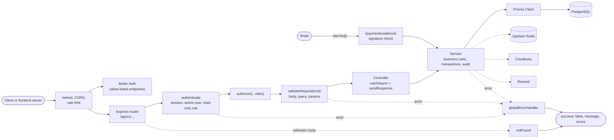
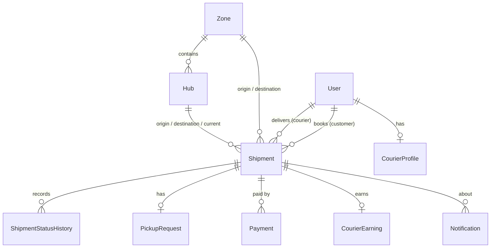
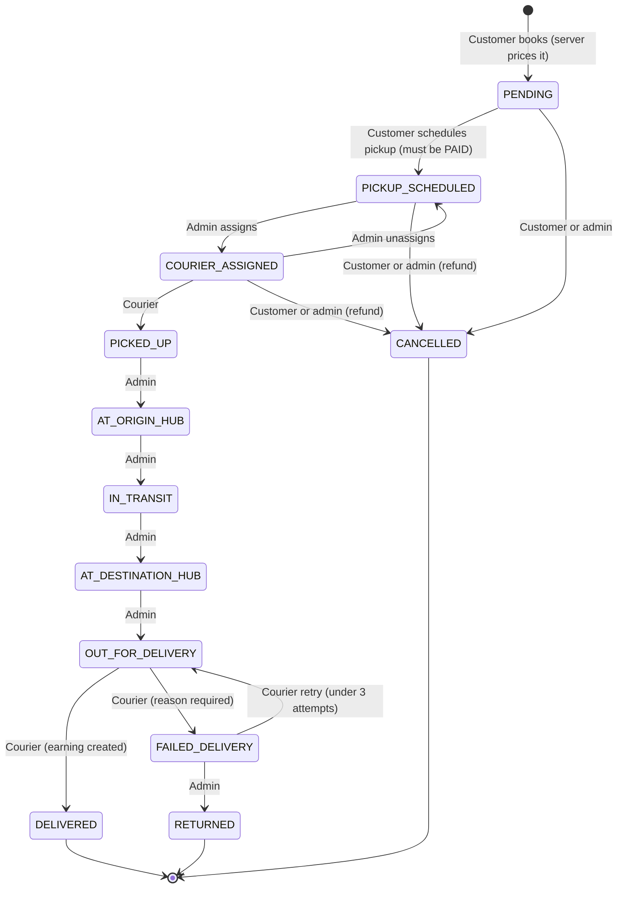
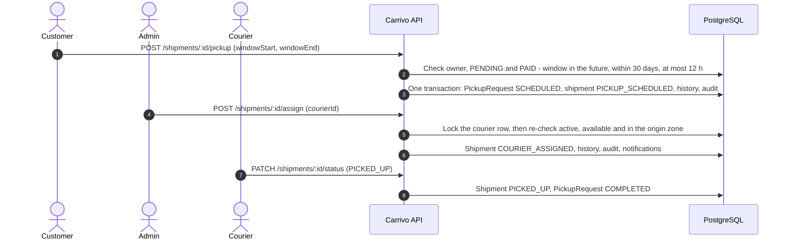
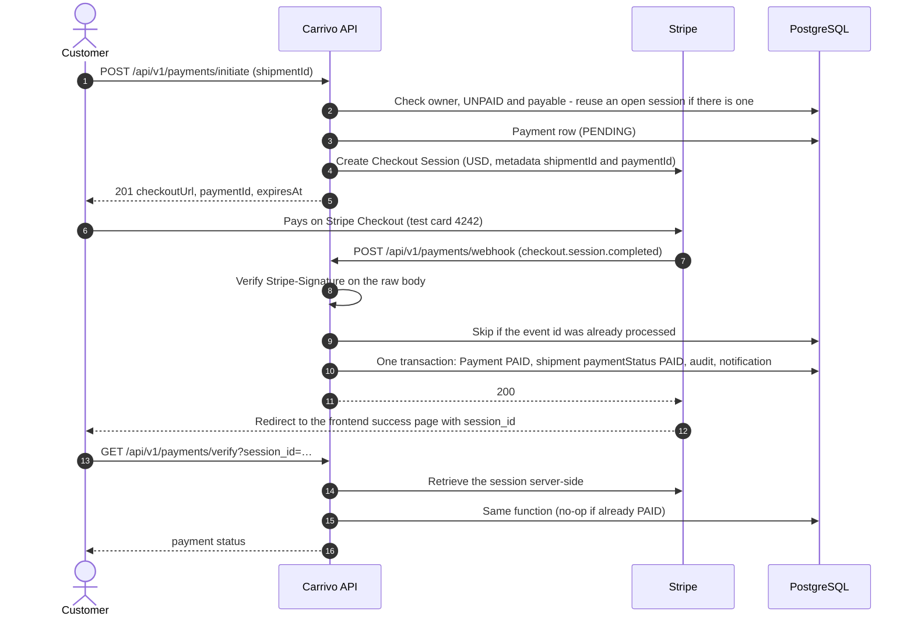

<div align="center">


# 📦 Carrivo

</div>

**Door-to-door parcel delivery, in one API.** A REST API for a US courier platform: customers book and pay for shipments, couriers pick them up and deliver them with a photo, admins run zones, hubs, pricing, assignments, payments and users, and a read-only admin viewer can see everything without changing anything.

[](https://carrivo-backend.vercel.app/api/v1/health)


[](LICENSE)

## Contents

- [📦 Carrivo](#-carrivo)
  - [Contents](#contents)
  - [🔗 Links](#-links)
  - [🔑 Demo accounts](#-demo-accounts)
  - [🔒 Security](#-security)
  - [Overview](#overview)
  - [Features](#features)
  - [Tech stack](#tech-stack)
  - [Architecture](#architecture)
  - [Project structure](#project-structure)
  - [Database](#database)
    - [Shipment lifecycle](#shipment-lifecycle)
    - [Pickup flow](#pickup-flow)
  - [Payment flow](#payment-flow)
  - [API reference](#api-reference)
  - [Response \& error format](#response--error-format)
  - [Filtering, search, pagination \& sorting](#filtering-search-pagination--sorting)
  - [Getting started](#getting-started)
    - [Prerequisites](#prerequisites)
    - [Setup](#setup)
    - [Environment variables](#environment-variables)
    - [Stripe webhooks locally](#stripe-webhooks-locally)
  - [Scripts](#scripts)
  - [Deployment](#deployment)
  - [Operations](#operations)
  - [Testing with Postman](#testing-with-postman)
  - [Technical challenges solved](#technical-challenges-solved)
  - [Known limitations \& future improvements](#known-limitations--future-improvements)
  - [Author](#author)
  - [License](#license)

## 🔗 Links

|                     |                                                                                                                  |
| ------------------- | ---------------------------------------------------------------------------------------------------------------- |
| **Live API**        | [https://carrivo-backend.vercel.app/api/v1](https://carrivo-backend.vercel.app/api/v1)                           |
| **Health check**    | [https://carrivo-backend.vercel.app/api/v1/health](https://carrivo-backend.vercel.app/api/v1/health) (status and database check) |
| **Frontend site**   | [https://carrivo-courier.vercel.app](https://carrivo-courier.vercel.app)                                         |
| **Frontend repo**   | [Zarif207/Carrivo](https://github.com/Zarif207/Carrivo) (Next.js)                                                |
| **API docs**        | [`docs/api.md`](docs/api.md)                                                                                     |
| **Postman**         | [`docs/postman_collection.json`](docs/postman_collection.json)                                                   |
| **Database design** | [`docs/ERD.md`](docs/ERD.md)                                                                                     |

Hosting: Vercel (one serverless function). Database: PostgreSQL (Neon). Cache and shared rate limits: Upstash Redis. Images: Cloudinary. Email: Resend. Payments: Stripe (test mode).

## 🔑 Demo accounts

| Role                     | Email                   | Password              |
| ------------------------ | ----------------------- | --------------------- |
| Customer                 | `customer1@carrivo.dev` | `Carrivo#Demo2026!x7` |
| Courier                  | `courier1@carrivo.dev`  | `Carrivo#Demo2026!x7` |
| Admin viewer (read-only) | `viewer@carrivo.dev`    | `Carrivo#Demo2026!x7` |

These are public demo values. The admin account is private; use the admin viewer to explore the admin endpoints.

The **admin viewer** (`ADMIN_VIEWER`) can call every admin and staff `GET` endpoint (dashboard stats, users, shipments, payments, audit logs, zones, hubs, pricing rules, couriers) and gets the same data an admin sees. Every write returns **403** ("This account is read-only"), including its own profile, password and mark-as-read; only logout and refresh-token are allowed. It can't use customer- or courier-only routes.

**Stripe test card:** `4242 4242 4242 4242`, any future expiry date, any CVC. Payments run in Stripe **test mode**; no real money is charged.

## 🔒 Security

- `helmet` headers, no `x-powered-by`, `trust proxy` for one hop (Vercel), a 100 KB JSON limit and a size guard in front of Better Auth; the Stripe webhook keeps its raw body.
- CORS limited to an allow-list of origins; other browser origins get 403.
- Rate limits on every route (300 requests per 15 minutes per visitor) and a stricter one on login, register, change password and Google sign-in (20 failed attempts per 15 minutes). Counters live in Redis, so all serverless instances share them. When the frontend's server sends the shared header (compared in constant time) together with the visitor's IP, that IP is the key, so visitors behind the frontend don't share one bucket; a browser can't choose its own key.
- Zod validation on every body, query and params; bodies are strict, so fields such as `role` on sign-up are rejected. US address, phone and ZIP formats are checked.
- Sessions come from Better Auth: bearer tokens that last 7 days, rotation revokes the old token, logout and deactivation revoke sessions, and only an allow-list of Better Auth endpoints is reachable (nothing that returns raw tokens or acts as a password oracle).
- Password hashing is Better Auth's; responses never include password hashes, session tokens or provider secrets, and audit snapshots are redacted.
- Roles are checked on every request (`authenticate` then `authorize`), ownership in services (another user's record answers 404), and one central read-only rule for `ADMIN_VIEWER`.
- Stripe webhooks are verified against the signature on the raw body, and each event is processed once.
- Production errors never include stack traces; only 5xx errors are logged, without request headers or bodies.
- Seed and reset scripts refuse a production database unless the operator confirms its host; the reset also needs an exact typed phrase.

See [docs/api.md](docs/api.md#security-limits) for the exact limits.

## Overview

Carrivo is the backend for a US courier and logistics platform with four roles:

- **Customer:** gets a price, books a shipment, pays with Stripe Checkout, schedules a pickup window, tracks it and can cancel before pickup (refunded if paid). Everyone who signs up, including with Google, is a customer.
- **Courier:** sees assigned tasks, moves them through the allowed steps, uploads a proof-of-delivery photo, sees earnings and sets availability. Created by an admin.
- **Admin:** manages zones, hubs and pricing rules, assigns couriers, moves parcels through the hubs, handles refunds, creates and manages users, and reads the dashboard stats and audit log. Created by the seed or by another admin.
- **Admin viewer:** reads everything an admin can and changes nothing. Created only by the seed; it can never be granted through the API.

US conventions throughout: prices in US dollars, weights in pounds (`weightLb`), addresses as `street, City, ST 12345`, US phone numbers, and business dates in America/New_York (daylight saving included).

## Features

<details open>
<summary><b>Public</b></summary>

- Zones and hubs, with search, filters, pagination and sorting (cached)
- Live price estimate for a zone pair, service and weight, priced by distance tier (metro, regional, national); the seeded network has 8 US metro zones and 16 hubs
- Public tracking by tracking id (`CRV-YYMMDD-XXXXXX`): stops, cities and times only, never names, phone numbers or addresses
- Register (always `CUSTOMER`) and log in with email and password, or sign in with Google
- Health check with a database probe

</details>

<details>
<summary><b>Customer</b></summary>

- Create shipments; the server prices them and issues the tracking id
- Edit a shipment before payment (weight or service changes re-price it); cancel before pickup, with a Stripe refund if it was paid
- Pay with Stripe Checkout; the success page is verified server-side
- Schedule a pickup window (in the future, within 30 days, at most 12 hours) once paid
- List own shipments and payments with filters; shipment detail with the full status history
- Profile, in-app notifications and lifecycle emails

</details>

<details>
<summary><b>Courier</b></summary>

- Active tasks with search, status filter and sorting
- Only the next allowed status: picked up, delivered, failed with a reason, and retry (up to 3 attempts)
- Proof-of-delivery photo: JPEG, PNG or WebP up to 4 MB, file bytes checked, stored on Cloudinary
- Earnings (20 percent of each delivered shipment) with a summary and filters; availability on or off

</details>

<details>
<summary><b>Admin</b></summary>

- Dashboard stats: shipments by status and per day, revenue, payments by status, failed delivery rate, top couriers, counts
- All shipments: assign and unassign couriers (only available couriers in the origin zone, concurrency-safe), hub steps, returns, cancel, soft delete
- Zones, hubs and pricing rules: create, update, deactivate, soft delete (refused while in use)
- Users: list and search, create couriers and admins, change roles, activate and deactivate (sessions revoked; the last admin is protected)
- Payments: list with filters, flag for review, retry a pending refund
- Audit log of every change, with filters

</details>

<details>
<summary><b>Admin viewer (read-only)</b></summary>

- Every admin and staff `GET` endpoint, with the same data an admin sees
- Every write refused with 403 by one central rule, including Better Auth's own endpoints

</details>

<details>
<summary><b>Notifications and email</b></summary>

- Notifications for shipment created, courier assigned, picked up, out for delivery, delivered, failed delivery, payment received and refund completed
- Written in the same transaction as the change; the email (Resend) goes out after the commit, and an email failure never fails the request
- List (all, unread or read), mark one read, mark all read

</details>

## Tech stack

| Technology                                   | Used for                                                                 |
| -------------------------------------------- | ------------------------------------------------------------------------ |
| **Node.js 24** (≥ 22.12) + **Express 5**     | HTTP server and routing                                                  |
| **TypeScript 5.9** (strict, ES modules)      | Type safety from the Prisma schema to the responses                      |
| **PostgreSQL** (Neon)                        | Relational database with transactions and row locks                      |
| **Prisma 7** + `@prisma/adapter-pg`          | Schema, migrations, type-safe queries (through the `pg` driver adapter)  |
| **Zod 4**                                    | Request validation (body, query, params)                                 |
| **Better Auth**                              | Email/password, Google OAuth, bearer sessions, password hashing          |
| **Stripe**                                   | Checkout Sessions, signed webhooks, refunds                              |
| **Upstash Redis**                            | Cache and shared rate-limit counters over REST (works from serverless)   |
| **Multer** + **Cloudinary**                  | Proof-of-delivery uploads (in memory, then stored on Cloudinary)         |
| **Resend**                                   | Notification emails                                                      |
| **helmet**, **cors**, **express-rate-limit** | HTTP hardening, origin allow-list, rate limits                           |
| **`node:test`** + **tsx**                    | 181 unit and HTTP tests                                                  |
| **Vercel**                                   | Serverless deployment (`api/index.ts`)                                   |

## Architecture



**Layers:** routes → controllers → services → Prisma. Routes hold only the path, the middleware and the controller; controllers are thin; services hold every business rule and every database call.

**Module pattern:** each feature lives in `src/app/modules/<name>/` with the same files:

| File                     | Responsibility                                                            |
| ------------------------ | ------------------------------------------------------------------------- |
| `<name>.route.ts`        | Routes with `authenticate`, `authorize(...roles)` and `validateRequest`   |
| `<name>.validation.ts`   | Zod schemas shaped as `{ body, query, params }`                           |
| `<name>.controller.ts`   | Thin handlers wrapped in `catchAsync`; respond through `sendResponse`     |
| `<name>.service.ts`      | Business rules and Prisma queries; throw `ApiError(status, message)`      |
| `<name>.types.ts`, `*.constants.ts`, `*.utils.ts` | Types, constants (sort fields, transitions) and pure helpers with tests |

Module routers are flat (no nested routers), so the read-only test can walk every route.

## Project structure

<details>
<summary>Show tree</summary>

```
├── api/
│   └── index.ts                 # Vercel serverless entry (exports the Express app)
├── docs/
│   ├── api.md                   # Request and response shapes for every endpoint
│   ├── ERD.md                   # Database design, ERD, constraints, indexes
│   ├── DEPLOYMENT.md            # Production checklist
│   └── postman_collection.json  # Every endpoint with examples, plus an RBAC matrix
├── prisma/
│   ├── schema.prisma            # Models and enums
│   ├── migrations/              # SQL migrations
│   ├── seed.ts, seed.safety.ts  # Idempotent US demo seed and its guards
│   ├── seed.network.ts          # Demo network: 8 zones, 16 hubs, 54 distance-tier pricing rules
│   └── reset-demo.ts, reset.safety.ts   # Guarded demo-data reset and its guards
├── scripts/                     # Smoke test and dev-only helpers (never deployed)
├── src/
│   ├── server.ts                # Local entry (app.listen)
│   ├── app.ts                   # Middleware order, webhook, auth, routes, 404 and error handlers
│   └── app/
│       ├── config/              # Validated env, roles, currency, frontend paths
│       ├── lib/                 # prisma, auth (Better Auth), stripe, redis, cache, cloudinary, email
│       ├── middlewares/         # authenticate, readOnly, authorize, validateRequest, rate limits, upload, errors
│       ├── errors/              # Zod, Prisma and Better Auth error mappers
│       ├── routes/index.ts      # Mounts every module router under /api/v1
│       ├── utils/               # sendResponse, catchAsync, ApiError, pagination, money, timezone, US validation
│       └── modules/             # auth, user, zone, hub, pricing, shipment, tracking,
│                                #   courier, payment, admin, audit, notification, health
├── prisma.config.ts             # Prisma CLI config (schema, migrations, seed, DIRECT_URL)
└── vercel.json                  # One function, every path rewritten to it
```

</details>

## Database

Sixteen tables: **User**, **Session**, **Account** and **Verification** (Better Auth), **Zone**, **Hub**, **PricingRule**, **CourierProfile**, **Shipment**, **ShipmentStatusHistory**, **PickupRequest**, **Payment**, **StripeEvent**, **CourierEarning**, **AuditLog** and **Notification**. The diagram shows the shipment core. Highlights:

- Domain ids are **UUID v7**; money is `Decimal(10,2)` in US dollars and weights are `Decimal(8,2)` pounds.
- **Unique:** `Shipment.trackingId`, one `PickupRequest` and one `CourierEarning` per shipment, one `CourierProfile` per courier, and every Stripe id on `Payment`.
- Mutable rows are **soft-deleted** (`deletedAt`) and every read excludes them; foreign keys restrict deletes, so history can't be lost.
- **Indexed** on every filter and sort: shipment status, payment status, customer and courier with date, zones, service type, dates; trigram GIN indexes back the case-insensitive search on tracking id, receiver name and phone.
- **Transactions:** every status change, payment update and user change runs in `prisma.$transaction` with its history, audit and notification rows; conditional updates and `SELECT … FOR UPDATE` row locks stop concurrent double changes.



Every model, field, constraint, index and enum is documented in **[`docs/ERD.md`](docs/ERD.md)**.

### Shipment lifecycle



One transition table (`TRANSITIONS` in `src/app/modules/shipment/shipment.constants.ts`) lists the roles allowed for each move, and every change goes through one service function. An illegal move answers 400 with the allowed next statuses, a legal move by the wrong role 403, someone else's shipment 404, and a concurrent change 409.

### Pickup flow



Cancelling before pickup marks the pickup request `CANCELLED`; unassigning sends the shipment back to `PICKUP_SCHEDULED`.

## Payment flow



- **Idempotent:** processed Stripe event ids are stored in `stripe_events`, and an already-PAID payment is ignored, so whichever of the webhook or the verify call runs first does the work and the other changes nothing.
- **Never from the client:** a payment is marked paid only by the verified webhook or the server-side session lookup, never because of a redirect or a request body.
- **Status updates:** `checkout.session.expired` marks the payment `EXPIRED`; failed or declined payments mark it `FAILED`; an amount mismatch or a duplicate payment sets `requiresReview`.
- **Refunds:** cancelling a paid shipment before pickup moves the payment to `REFUND_PENDING` and creates a Stripe refund; `charge.refunded` and `refund.failed` settle it, and an admin can retry a stuck refund.
- **Raw body:** the webhook route is registered before `express.json()` and the rate limiter, so the signature check sees the exact bytes Stripe sent.

## API reference

Every endpoint the API serves: 58 of ours plus 6 allow-listed Better Auth endpoints, all under `/api/v1` except the root. Request and response shapes are in [`docs/api.md`](docs/api.md). "Any" means any signed-in role; "Staff" means Admin and Admin viewer (reads only).

| Method | Path                                    | Role               | Description                                                     |
| ------ | --------------------------------------- | ------------------ | --------------------------------------------------------------- |
| GET    | `/`                                     | –                  | API is running                                                  |
| GET    | `/api/v1/health`                        | –                  | Health check with a database probe                              |
| POST   | `/api/v1/auth/register`                 | –                  | Sign up (always `CUSTOMER`), returns a token                    |
| POST   | `/api/v1/auth/login`                    | –                  | Log in, returns a bearer token                                  |
| POST   | `/api/v1/auth/logout`                   | Any                | Revoke the current session                                      |
| POST   | `/api/v1/auth/refresh-token`            | Any                | Rotate the session (old token revoked)                          |
| GET    | `/api/v1/auth/google`                   | –                  | Start Google sign-in (302, needs a PKCE challenge)              |
| GET    | `/api/v1/auth/google/complete`          | Browser            | Landing after Google; 302 to the frontend with a one-time code |
| POST   | `/api/v1/auth/google/exchange`          | –                  | Exchange the code and verifier for a token                     |
| POST   | `/api/v1/auth/change-password`          | Any (not viewer)   | Better Auth: change password                                    |
| GET    | `/api/v1/auth/get-session`              | Any                | Better Auth: current session                                    |
| POST   | `/api/v1/auth/revoke-sessions`          | Any (not viewer)   | Better Auth: sign out everywhere                                |
| POST   | `/api/v1/auth/revoke-other-sessions`    | Any (not viewer)   | Better Auth: sign out other devices                             |
| GET    | `/api/v1/auth/ok`                       | –                  | Better Auth health                                              |
| GET    | `/api/v1/auth/callback/google`          | –                  | Better Auth: Google redirect URI                                |
| GET    | `/api/v1/users/me`                      | Any                | Own profile                                                     |
| PATCH  | `/api/v1/users/me`                      | Any (not viewer)   | Update name, phone, address or image                            |
| GET    | `/api/v1/zones`                         | –                  | List zones (cached)                                             |
| GET    | `/api/v1/zones/:id`                     | –                  | Zone details                                                    |
| POST   | `/api/v1/zones`                         | Admin              | Create a zone                                                   |
| PATCH  | `/api/v1/zones/:id`                     | Admin              | Update or deactivate a zone                                     |
| DELETE | `/api/v1/zones/:id`                     | Admin              | Soft delete (refused while in use)                              |
| GET    | `/api/v1/hubs`                          | –                  | List hubs (cached)                                              |
| GET    | `/api/v1/hubs/:id`                      | –                  | Hub details                                                     |
| POST   | `/api/v1/hubs`                          | Admin              | Create a hub                                                    |
| PATCH  | `/api/v1/hubs/:id`                      | Admin              | Update or deactivate a hub                                      |
| DELETE | `/api/v1/hubs/:id`                      | Admin              | Soft delete (refused while in use)                              |
| POST   | `/api/v1/pricing/estimate`              | –                  | Price quote for a route, service and weight                     |
| GET    | `/api/v1/pricing`                       | Staff              | List pricing rules                                              |
| GET    | `/api/v1/pricing/:id`                   | Staff              | Pricing rule details                                            |
| POST   | `/api/v1/pricing`                       | Admin              | Create a pricing rule                                           |
| PATCH  | `/api/v1/pricing/:id`                   | Admin              | Update a pricing rule                                           |
| DELETE | `/api/v1/pricing/:id`                   | Admin              | Soft delete a pricing rule                                      |
| POST   | `/api/v1/shipments`                     | Customer           | Create a shipment (server-priced, new tracking id)              |
| GET    | `/api/v1/shipments`                     | Any                | List shipments (customer: own, courier: assigned, staff: all)   |
| GET    | `/api/v1/shipments/:id`                 | Any                | Shipment details with status history (scoped the same way)      |
| PATCH  | `/api/v1/shipments/:id`                 | Customer           | Edit own shipment before payment (re-priced)                    |
| POST   | `/api/v1/shipments/:id/cancel`          | Customer, Admin    | Cancel before pickup (refund if paid)                           |
| DELETE | `/api/v1/shipments/:id`                 | Admin              | Soft delete (pending or finished shipments only)                |
| POST   | `/api/v1/shipments/:id/pickup`          | Customer           | Schedule the pickup window (requires PAID)                      |
| POST   | `/api/v1/shipments/:id/assign`          | Admin              | Assign a courier                                                |
| POST   | `/api/v1/shipments/:id/unassign`        | Admin              | Unassign the courier                                            |
| PATCH  | `/api/v1/shipments/:id/status`          | Courier, Admin     | Status change through the state machine                         |
| POST   | `/api/v1/shipments/:id/proof`           | Courier            | Upload the proof-of-delivery photo (multipart, 4 MB)            |
| GET    | `/api/v1/tracking/:trackingId`          | –                  | Public tracking timeline (cached 15 s)                          |
| GET    | `/api/v1/couriers`                      | Staff              | Couriers for assignment                                         |
| GET    | `/api/v1/couriers/me/tasks`             | Courier            | My tasks                                                        |
| GET    | `/api/v1/couriers/me/earnings`          | Courier            | My earnings with a summary                                      |
| PATCH  | `/api/v1/couriers/me/availability`      | Courier            | Set my availability                                             |
| GET    | `/api/v1/admin/dashboard-stats`         | Staff              | Dashboard statistics (cached 60 s)                              |
| GET    | `/api/v1/admin/users`                   | Staff              | List users                                                      |
| POST   | `/api/v1/admin/users`                   | Admin              | Create a courier or an admin                                    |
| PATCH  | `/api/v1/admin/users/:id/role`          | Admin              | Change a role (`CUSTOMER`, `COURIER` or `ADMIN`)                |
| PATCH  | `/api/v1/admin/users/:id/status`        | Admin              | Activate or deactivate a user                                   |
| GET    | `/api/v1/admin/audit-logs`              | Staff              | Audit log                                                       |
| GET    | `/api/v1/admin/payments`                | Staff              | All payments with filters                                       |
| POST   | `/api/v1/admin/payments/:id/refund`     | Admin              | Retry or complete a pending refund                              |
| POST   | `/api/v1/payments/initiate`             | Customer           | Create a Stripe Checkout Session                                |
| GET    | `/api/v1/payments/verify`               | Customer, Admin    | Verify a Checkout Session after the redirect                    |
| GET    | `/api/v1/payments/my`                   | Customer           | My payments                                                     |
| GET    | `/api/v1/payments/:id`                  | Customer, Staff    | Payment details (customers: own only)                           |
| POST   | `/api/v1/payments/webhook`              | Stripe             | Stripe webhook (signature verified, idempotent)                 |
| GET    | `/api/v1/notifications/my`              | Any                | My notifications                                                |
| PATCH  | `/api/v1/notifications/read-all`        | Any (not viewer)   | Mark all as read                                                |
| PATCH  | `/api/v1/notifications/:id/read`        | Any (not viewer)   | Mark one as read                                                |

## Response & error format

**Success**

```json
{
  "success": true,
  "message": "Shipments retrieved successfully",
  "meta": { "page": 1, "limit": 10, "total": 12, "totalPages": 2 },
  "data": []
}
```

`meta` appears only on paginated lists. Money (`price`, `amount`, `baseFee`) is returned as a 2-decimal string (`"6.00"`), weights as decimal strings in pounds.

**Error:** every error uses the same shape:

```json
{
  "success": false,
  "message": "Validation failed",
  "errors": [
    { "path": "body.weightLb", "message": "Weight must be greater than 0" },
    { "path": "body.receiverPhone", "message": "Enter a US phone number, e.g. (212) 555-0142 or +1 212-555-0142" }
  ]
}
```

| Handled error                                                                                             | Status |
| --------------------------------------------------------------------------------------------------------- | ------ |
| Zod validation, malformed JSON, an illegal status move, a broken reference (Prisma **P2003**)             | 400    |
| Missing, invalid, expired or revoked token                                                                 | 401    |
| Wrong role, read-only account, deactivated account, origin not allowed by CORS                            | 403    |
| Unknown route, missing record, another user's record, Prisma **P2025**                                    | 404    |
| Duplicate value (Prisma **P2002**), state conflicts, concurrent changes, records still in use             | 409    |
| Body or upload too large                                                                                   | 413    |
| Upload that isn't multipart                                                                                | 415    |
| No pricing rule for the route, weight over the maximum, amount below Stripe's minimum                     | 422    |
| Rate limit (with `RateLimit` headers)                                                                      | 429    |
| Unexpected errors (no details or stack in production)                                                      | 500    |
| Database unreachable                                                                                       | 503    |

## Filtering, search, pagination & sorting

Every list accepts these, plus its own filters:

| Param                   | Example                         | Notes                                                                 |
| ----------------------- | ------------------------------- | --------------------------------------------------------------------- |
| `searchTerm`            | `searchTerm=crv-2611`           | case-insensitive; fields depend on the list (see below)               |
| `page`, `limit`         | `page=2&limit=20`               | `page` default 1; `limit` default 10, max 100                         |
| `sortBy`, `sortOrder`   | `sortBy=price&sortOrder=asc`    | a whitelist per list; `sortOrder` default `desc`; ties broken by id   |
| `fromDate`, `toDate`    | `fromDate=2026-11-01`           | a whole day in America/New_York, or an ISO date-time with offset      |
| boolean filters         | `isActive=false`                | the strings `true` and `false`                                        |

| List                       | `searchTerm` fields                  | Filters                                                                 | `sortBy`                                                   |
| -------------------------- | ------------------------------------ | ----------------------------------------------------------------------- | ---------------------------------------------------------- |
| `GET /shipments`           | tracking id, receiver name, phone    | `status`, `serviceType`, `paymentStatus`, dates, `customerId`, `courierId` | `createdAt`, `updatedAt`, `price`, `weightLb`, `status`, `trackingId` |
| `GET /zones`               | name, code                           | `isActive` (`true`, `false`, `all`)                                     | `name`, `code`, `createdAt`                                |
| `GET /hubs`                | name, code, city                     | `zoneId`, `city`, `isActive`                                            | `name`, `code`, `city`, `createdAt`                        |
| `GET /pricing`             | name                                 | `serviceType`, `originZoneId`, `destinationZoneId`, `isActive`          | `name`, `serviceType`, `baseFee`, `perLbFee`, `createdAt`  |
| `GET /couriers`            | name, email, phone                   | `zoneId`, `hubId`, `available`                                          | `name`, `createdAt`                                        |
| `GET /couriers/me/tasks`   | tracking id, receiver name, phone    | `status`                                                                | `createdAt`, `updatedAt`, `status`                         |
| `GET /admin/users`         | name, email, phone                   | `role`, `status`                                                        | `name`, `email`, `createdAt`, `role`, `status`             |
| `GET /admin/payments`      | –                                    | `status`, `customerId`, `shipmentId`, `requiresReview`, dates           | `createdAt`, `amount`, `paidAt`, `status`                  |
| `GET /admin/audit-logs`    | –                                    | `actorId`, `action`, `entityType`, `entityId`, dates                    | newest first (`sortOrder`)                                 |

```
GET https://carrivo-backend.vercel.app/api/v1/shipments?status=IN_TRANSIT&serviceType=EXPRESS&fromDate=2026-11-01&page=1&limit=5&sortBy=createdAt&sortOrder=desc
```

See [`docs/api.md`](docs/api.md#conventions) for every list's filters.

## Getting started

### Prerequisites

- Node.js **22.12 or newer** (developed on 24)
- A PostgreSQL database (local or a cloud development branch)
- A Stripe account in **test mode** (and optionally the [Stripe CLI](https://docs.stripe.com/stripe-cli) for local webhooks)
- A Google OAuth client and a Cloudinary account (both required at startup); Upstash Redis and Resend are optional

### Setup

```bash
git clone https://github.com/Zarif207/carrivo-backend.git
cd carrivo-backend
npm install                 # also runs prisma generate
cp .env.example .env        # fill in the values below
npm run db:deploy           # apply migrations
npm run db:seed             # US demo data (zones, hubs, pricing, accounts, shipments)
npm run dev                 # http://localhost:5000/api/v1/health
```

### Environment variables

The app validates them at startup and lists missing or invalid **names**, never values. Names and example shapes only:

| Variable                     | Required        | Example shape and purpose                                                         |
| ---------------------------- | --------------- | --------------------------------------------------------------------------------- |
| `NODE_ENV`                   |                 | `development`, `production` or `test`                                             |
| `PORT`                       |                 | `5000` (local only)                                                               |
| `DATABASE_URL`               | ✅              | A pooled PostgreSQL connection string, used at runtime                            |
| `DIRECT_URL`                 |                 | The direct (non-pooled) connection string, used by the Prisma CLI for migrations |
| `CORS_ORIGINS`               |                 | `http://localhost:3000` (comma-separated origins)                                 |
| `FRONTEND_URL`               |                 | `http://localhost:3000` (email links, Google landing)                             |
| `FRONTEND_SUCCESS_URL`       | ✅              | `http://localhost:3000/payment/success` (`session_id` is appended)                |
| `FRONTEND_CANCEL_URL`        | ✅              | `http://localhost:3000/payment/cancel`                                            |
| `BETTER_AUTH_SECRET`         | ✅              | Random string, 32+ characters                                                     |
| `BETTER_AUTH_URL`            | ✅              | `http://localhost:5000` (this API's origin, no path)                              |
| `BFF_SHARED_SECRET`          | production      | Random string, 32+ characters, the same value as the frontend's                   |
| `GOOGLE_CLIENT_ID`           | ✅              | Google OAuth client id                                                            |
| `GOOGLE_CLIENT_SECRET`       | ✅              | Google OAuth client secret                                                        |
| `STRIPE_SECRET_KEY`          | ✅              | Stripe secret key from test mode                                                  |
| `STRIPE_WEBHOOK_SECRET`      | ✅              | The webhook endpoint's signing secret                                             |
| `UPSTASH_REDIS_REST_URL`     |                 | Upstash REST URL (without it: no cache, in-memory rate limits)                    |
| `UPSTASH_REDIS_REST_TOKEN`   |                 | Upstash REST token                                                                |
| `REDIS_KEY_PREFIX`           |                 | `carrivo:v1:` (one prefix per environment)                                        |
| `CLOUDINARY_CLOUD_NAME`      | ✅              | Cloudinary cloud name                                                             |
| `CLOUDINARY_API_KEY`         | ✅              | Numeric Cloudinary API key                                                        |
| `CLOUDINARY_API_SECRET`      | ✅              | Cloudinary API secret                                                             |
| `RESEND_API_KEY`             |                 | Resend API key (without it, notifications are stored, not emailed)                |
| `EMAIL_FROM`                 |                 | `Carrivo <notifications@your-domain.example>`                                     |
| `SEED_DEMO_PASSWORD`         | seed and reset  | Password of the demo accounts                                                     |
| `SEED_ADMIN_PASSWORD`        |                 | A separate password for the admin account (must differ from the demo password)    |
| `SEED_CONFIRM_DB_HOST`       | production seed, every reset | The target database host, typed to confirm                           |
| `SEED_RESET_DEMO_PASSWORDS`  |                 | `true` re-sets existing demo accounts' passwords (audited)                        |
| `RESET_CONFIRM`              | reset           | Exactly `reset demo data on <host>`                                               |
| `DEV_ALLOW_MARK_PAID`        | dev only        | `true` enables the mark-paid helper locally                                       |

Seed, reset, smoke and dev-only variables are never set in Vercel.

### Stripe webhooks locally

```bash
stripe listen --forward-to localhost:5000/api/v1/payments/webhook \
  --events checkout.session.completed,checkout.session.async_payment_succeeded,checkout.session.async_payment_failed,checkout.session.expired,payment_intent.payment_failed,charge.refunded,refund.failed
```

Copy the printed signing secret into `STRIPE_WEBHOOK_SECRET` and restart `npm run dev`. Without the Stripe CLI, the frontend's success page (`GET /payments/verify`) still marks the payment paid through a server-side session lookup.

For Google locally, add `http://localhost:5000/api/v1/auth/callback/google` as an authorized redirect URI of your OAuth client.

## Scripts

| Script                                   | What it does                                                                         |
| ---------------------------------------- | ------------------------------------------------------------------------------------ |
| `npm run dev`                            | Start with hot reload (`tsx watch`)                                                  |
| `npm run build`                          | `prisma generate` + compile with `tsc`                                               |
| `npm start`                              | Run the compiled server                                                              |
| `npm run typecheck`                      | `tsc --noEmit`                                                                       |
| `npm test`                               | 181 unit and HTTP tests (`node:test`; no database or network needed)                 |
| `npm run smoke -- <baseUrl>`             | Read-only smoke test against any deployment (about 60 requests)                      |
| `npm run db:generate`                    | Generate the Prisma client                                                           |
| `npm run db:migrate`                     | `prisma migrate dev` (development)                                                   |
| `npm run db:deploy`                      | `prisma migrate deploy` (uses `DIRECT_URL`)                                          |
| `npm run db:seed`                        | Idempotent US demo seed                                                              |
| `npm run db:reset-demo`                  | Guarded reset of demo data, then reseed                                              |
| `npm run db:studio`                      | Prisma Studio                                                                        |
| `npm run dev:mark-paid -- <trackingId>`  | Dev only: mark a shipment paid without Stripe (refuses in production and on Vercel)  |

## Deployment

The API runs on **Vercel** as a single serverless function:

- `api/index.ts` exports the Express app; `src/server.ts` (with `app.listen`) is only for local use.
- `vercel.json` sets `framework: null`, rewrites every path to that function, sets the region and a 30-second maximum duration.
- There is no build step of its own: `postinstall` runs `prisma generate`, and Vercel compiles `api/index.ts` and everything it imports. `.vercelignore` keeps `scripts/`, `docs/`, tests and env files out of the upload.
- Node.js **22.x or 24.x** (`engines` requires ≥ 22.12).

**Steps**

1. Import the GitHub repo into Vercel (Framework preset: Other; leave build, output and install commands empty). Pushes to `main` deploy to production.
2. Add these in **Project → Settings → Environment Variables** (Production). Names and shapes only:
   - `DATABASE_URL` (pooled) and `DIRECT_URL` (direct) PostgreSQL connection strings.
   - `BETTER_AUTH_SECRET` (random, 32+ characters) and `BETTER_AUTH_URL`: `https://carrivo-backend.vercel.app`.
   - `FRONTEND_URL`: `https://carrivo-courier.vercel.app`; `CORS_ORIGINS`: a list that includes `https://carrivo-courier.vercel.app`.
   - `FRONTEND_SUCCESS_URL`: `https://carrivo-courier.vercel.app/payment/success`; `FRONTEND_CANCEL_URL`: `https://carrivo-courier.vercel.app/payment/cancel`.
   - `BFF_SHARED_SECRET`: the same value as the frontend's.
   - `STRIPE_SECRET_KEY` (test mode) and `STRIPE_WEBHOOK_SECRET` (from step 4).
   - `GOOGLE_CLIENT_ID`, `GOOGLE_CLIENT_SECRET`, the three `CLOUDINARY_*` values, the two `UPSTASH_REDIS_REST_*` values, `REDIS_KEY_PREFIX`, `RESEND_API_KEY` and `EMAIL_FROM`.
3. Apply migrations and seed as described in [Operations](#operations).
4. In the Stripe Dashboard (test mode), add a webhook endpoint:
   - URL: `https://carrivo-backend.vercel.app/api/v1/payments/webhook`
   - Events: `checkout.session.completed`, `checkout.session.async_payment_succeeded`, `checkout.session.async_payment_failed`, `checkout.session.expired`, `payment_intent.payment_failed`, `charge.refunded`, `refund.failed`
   - Put its signing secret in `STRIPE_WEBHOOK_SECRET` and redeploy.
5. In Google Cloud Console, add `https://carrivo-backend.vercel.app/api/v1/auth/callback/google` as an authorized redirect URI.
6. Check `/api/v1/health` and run `npm run smoke -- https://carrivo-backend.vercel.app/api/v1`.

The full checklist, including what fails on Vercel and how to avoid it, is in **[docs/DEPLOYMENT.md](docs/DEPLOYMENT.md)**.

## Operations

Run these from your machine with `DATABASE_URL` and `DIRECT_URL` exported for the target database. Only the owner runs them against production.

```bash
npm run db:deploy        # prisma migrate deploy: applies pending migrations through DIRECT_URL
npm run db:seed          # idempotent US demo seed
npm run db:reset-demo    # deletes demo data, then reseeds
```

| Command               | What its guards refuse                                                                                                                                                                                                                                         |
| --------------------- | ------------------------------------------------------------------------------------------------------------------------------------------------------------------------------------------------------------------------------------------------------------- |
| `npm run db:deploy`   | Nothing of its own: it only applies committed migrations. Check `npx prisma migrate status` first and take a database snapshot before a migration that changes data.                                                                                        |
| `npm run db:seed`     | With `NODE_ENV=production`: a missing or mismatched `SEED_CONFIRM_DB_HOST`, and a demo or admin password shorter than 16 characters, with fewer than 3 kinds of characters, containing a guessable word, or repeating one character 4+ times. It never resets an existing account's password unless `SEED_RESET_DEMO_PASSWORDS=true` (sessions revoked, audited), and never prints a password. |
| `npm run db:reset-demo` | Always (every environment): a `SEED_CONFIRM_DB_HOST` that doesn't equal the database host, and a `RESET_CONFIRM` that isn't exactly `reset demo data on <that host>`. It also refuses if a kept (non-demo) user still has a courier profile. All deletes run in one transaction; registered users who aren't demo or test accounts are kept. |

## Testing with Postman

1. **Import** [`docs/postman_collection.json`](docs/postman_collection.json).
2. **`baseUrl`** defaults to `http://localhost:5000/api/v1`; for the live API set it to `https://carrivo-backend.vercel.app/api/v1`.
3. Set the **`demoPassword`** collection variable to the demo password, then run **Auth → Login as Customer (demo)**, **Login as Courier (demo)** and **Login as Admin Viewer (demo, read-only)**. **Login as Admin (private credentials)** needs the private `adminEmail` variable and the admin's own password, or an admin from your own local seed.
4. Tokens are saved automatically (`customerToken`, `courierToken`, `viewerToken`, `adminToken`, and `token` for the last login), and each folder uses the right one. IDs are captured from responses (`zoneId`, `destinationZoneId`, `hubId`, `destinationHubId`, `pricingRuleId`, `shipmentId`, `trackingId`, `courierId`, `paymentId`, `userId`, `notificationId`, `otherShipmentId`, plus `pickupStart` and `pickupEnd`), so requests can run in order.

**Suggested demo order** (admin steps need the private login or a local seed)

1. Health → Health check
2. Zones → List zones, Hubs → List hubs (captures ids), Pricing → Estimate price
3. Customer → Shipments → Create shipment (server-priced, `PENDING`)
4. Customer → Payments → Initiate checkout → open `checkoutUrl`, pay with `4242 4242 4242 4242` → Verify after redirect (or let the webhook do it)
5. Customer → Shipments → Schedule pickup
6. Admin → Couriers → list, then Shipments → Assign courier
7. Courier → Status: PICKED_UP; Admin → hub steps → OUT_FOR_DELIVERY; Courier → Upload proof of delivery → Status: DELIVERED
8. Tracking → Track shipment (public, no personal data)
9. Admin Viewer → RBAC matrix → Admin Viewer (read-only): reads return 200, every write returns 403
10. Error cases in the **RBAC matrix** folder:
    - **401:** `401 · no token · GET /users/me`
    - **403 cross-role:** `403 · customer → GET /admin/users`, `403 · courier → POST /shipments`
    - **404:** `404 · customer → another customer's shipment`
    - **Validation error (400):** Auth → Register (customer) with an invalid body (its saved "400 Validation error" example shows the `errors` array)

## Technical challenges solved

<details>
<summary><b>Prisma and Express on Vercel: the static-build trap</b></summary>

The first deployments had a `vercel-build` script (`prisma generate && tsc --noEmit`) in `package.json`. With it, Vercel treated the project as a build-and-serve-output project instead of deploying `api/index.ts` as a function, so requests never reached Express. The fix was to remove `vercel-build` and let Vercel do what it does for `api/`: `postinstall` runs `prisma generate` (the client is generated into `src/generated/` with `.js` import extensions and an ESM module format, and needs no env vars at build time), `vercel.json` sets `framework: null`, and one rewrite sends every path to `/api`, so Express handles all routing. An import-graph check confirmed the function only bundles `src/app*` and the generated client, never the seed, the scripts or the tests.

</details>

<details>
<summary><b>Idempotent Stripe payments: webhook and verify</b></summary>

Both the Stripe webhook and `GET /payments/verify` (the success page's server-side lookup) can mark a payment paid, possibly at the same moment. They share one function: each processed event id is stored in `stripe_events`, and the update in the transaction is conditional on the payment not already being `PAID`. Whichever runs first marks the payment and the shipment paid and writes the audit row and the notification; the other changes nothing. A paid amount that doesn't match, or a second payment for an already-paid shipment, is flagged with `requiresReview` instead of being applied silently.

</details>

<details>
<summary><b>Per-visitor rate limiting behind a frontend server</b></summary>

The frontend calls the API from its own server, so every visitor arrived from the same IP and shared one rate-limit bucket. The limiter's key function (`src/app/utils/clientKey.ts`) now uses the frontend's forwarded `x-client-ip` only when the request also carries `x-bff-secret` matching `BFF_SHARED_SECRET`, compared in constant time; otherwise it uses the connecting IP. A browser can't pick its own key. Counters are stored in Redis through a small store for `express-rate-limit` (`redisRateLimitStore.ts`), so every serverless instance shares them, with an in-memory fallback.

</details>

<details>
<summary><b>One central read-only rule for ADMIN_VIEWER</b></summary>

Instead of adding a check to every write route, one function, `violatesReadOnly(role, method, url)` in `src/app/middlewares/readOnly.ts`, refuses every `POST`, `PUT`, `PATCH` and `DELETE` for `ADMIN_VIEWER` except logout and refresh-token. It runs inside `authenticate`, so every protected route gets it, and in front of Better Auth's own handler, so change-password and session revocation are covered too. Admin reads use `authorize(...STAFF_ROLES)`. `readOnly.test.ts` walks the real route table (the module routers are flat for this reason), so a route added later is covered automatically. The role can't be granted through the API: sign-up forces `CUSTOMER`, and role changes only accept `CUSTOMER`, `COURIER` or `ADMIN`.

</details>

<details>
<summary><b>Weights from kilograms to pounds, without losing data</b></summary>

The platform moved to US units after launch. Migration `20261108091000_weights_in_pounds` renames the columns (`weightKg` → `weightLb`, `baseWeightKg` → `baseWeightLb`, `perKgFee` → `perLbFee`, `maxWeightKg` → `maxWeightLb`) and converts the values in place: weights are multiplied by 2.20462 and per-pound fees divided by it, rounded to two decimals, nulls kept. Stored price breakdowns (JSON snapshots) have their keys and values rewritten too, only where the old keys exist. The migration and the code that reads the new columns have to ship together, so the API is redeployed right after the migration is applied.

</details>

<details>
<summary><b>Google sign-in for a bearer API: a one-time code handoff</b></summary>

Better Auth's Google flow ends with a cookie session on the API's domain, but the frontend is a separate site that uses bearer tokens. Putting a token in a redirect URL would leak it into history and logs. Instead, the frontend creates a PKCE verifier and starts at `GET /auth/google?challenge=…`; after Google, `/auth/google/complete` turns the session into a one-time code and redirects to the frontend with only that code. The frontend's server then calls `POST /auth/google/exchange` with the code and the verifier within 60 seconds and gets the same `{ token, expiresAt, user }` as login. The code works once and is useless without the verifier, Google sign-in never links to an existing password account, and new Google users are always customers.

</details>

## Known limitations & future improvements

- **Addresses are one validated line** (`street, City, ST 12345`) rather than structured fields.
- **Hubs and zones have no coordinates**, so there is no distance-based pricing or map data.
- **Courier payouts:** earnings are recorded as `PENDING`, but there is no endpoint to mark them paid yet.
- **Tasks have no date filter:** couriers see active tasks, not "today's" tasks.
- **No revenue time series:** dashboard stats give totals and shipments per day, not revenue per day.
- **Proof images on Cloudinary** aren't cleaned up when a shipment is soft-deleted or demo data is reset.
- **Region:** the function and data stores run in Singapore (`sin1`) next to the database; a US region would suit a US platform better.
- **No integration tests against a real database:** the 181 tests are unit and HTTP tests with the database and network mocked; migrations, the seed and the reset are checked by hand on a disposable branch, with the Postman collection and the smoke test against deployments.
- **Next:** an OpenAPI spec generated from the Zod schemas, audit records for refused (403) requests, live courier location and route optimisation, and a customer address book.

## Author

**Zarif Hasan** · [GitHub @Zarif207](https://github.com/Zarif207)

## License

Released under the MIT License. See [LICENSE](LICENSE).
