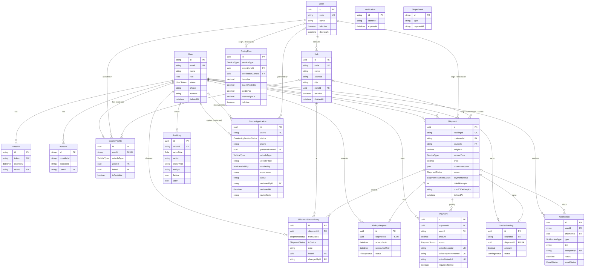
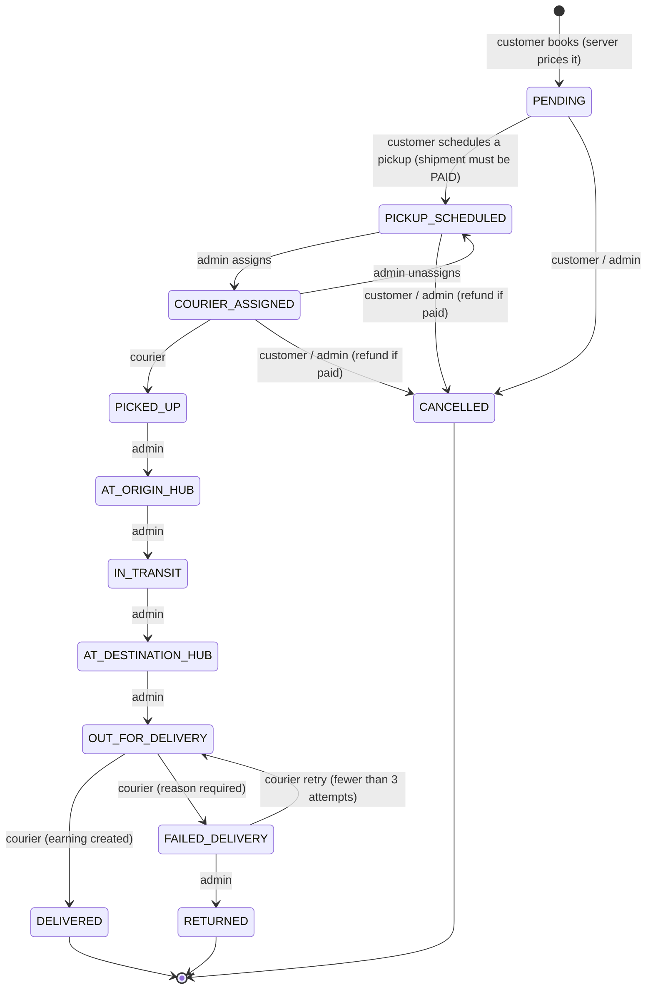

# Carrivo database design

PostgreSQL through Prisma 7. The schema is one file, [`prisma/schema.prisma`](../prisma/schema.prisma); migrations live in [`prisma/migrations/`](../prisma/migrations).

- **Ids:** domain rows use UUID v7 (`@default(uuid(7))`, time-ordered); Better Auth tables use the string ids Better Auth generates.
- **Money:** `Decimal(10,2)` in US dollars, returned by the API as 2-decimal strings (`"6.00"`).
- **Weights:** `Decimal(8,2)` in pounds (`weightLb`, `baseWeightLb`, `maxWeightLb`).
- **Soft delete:** mutable entities carry `deletedAt`; every read excludes deleted rows. Status history, audit logs, earnings and Stripe events are append-only. Notifications are personal inbox items: only their read state changes, and their owner may delete one.
- **Table names** are snake_case plurals (`@@map`).

## Entity relationship diagram

## Models

| Model (table) | Purpose | Notes |
| --- | --- | --- |
| `User` (`users`) | Every account | Better Auth core table plus `role`, `phone`, `address`, `status`, `deletedAt`. `role` can't be set by clients (Better Auth field with `input: false` and a create hook that forces `CUSTOMER`) |
| `Session` (`sessions`) | Bearer sessions | Unique `token`; deleted with the user (`onDelete: Cascade`) |
| `Account` (`accounts`) | Credential and Google accounts | Holds the password hash for email/password accounts; deleted with the user |
| `Verification` (`verifications`) | Better Auth's short-lived verification values | Managed by Better Auth |
| `Zone` (`zones`) | Delivery zone (a metro area) | Unique `code` (upper-cased); soft delete; can't be deleted while hubs or couriers use it |
| `Hub` (`hubs`) | Sorting hub inside a zone | Unique `code`; US address and city; soft delete; can't change zone or be deleted while in use |
| `PricingRule` (`pricing_rules`) | How a service is priced on a route | Either a route rule (both zones set) or the service's default rule (both null) |
| `CourierProfile` (`courier_profiles`) | Vehicle, zone, hub and availability of a courier | One per courier user (`userId` unique) |
| `CourierApplication` (`courier_applications`) | A customer's request to become a courier, and the admin's decision | At most one `PENDING` per user (partial unique index); a decision records `reviewedById`, `reviewedAt` and, for a rejection, `reviewNote`. Approval creates or restores the user's `CourierProfile` from it. Never stores licence, SSN or other government ID numbers. Append-only history (no `deletedAt`): rows only move `PENDING` → `APPROVED`, `REJECTED` or `CANCELLED` |
| `Shipment` (`shipments`) | A parcel from booking to the end | Unique `trackingId` (`CRV-YYMMDD-XXXXXX`); price and `priceBreakdown` snapshot set by the server; proof-of-delivery fields |
| `ShipmentStatusHistory` (`shipment_status_history`) | One row per status change | `changedById` null means the system (for example a webhook) |
| `PickupRequest` (`pickup_requests`) | The pickup window | One per shipment (`shipmentId` unique); `SCHEDULED` → `COMPLETED` on pickup or `CANCELLED` on cancel |
| `Payment` (`payments`) | One Stripe Checkout attempt | Unique Stripe session, payment intent and refund ids; `requiresReview` flags amount mismatches, duplicates and refund failures |
| `StripeEvent` (`stripe_events`) | Processed webhook event ids | Primary key is the Stripe event id: webhook idempotency |
| `CourierEarning` (`courier_earnings`) | The courier's share of a delivered shipment | One per shipment (`shipmentId` unique); `PENDING` or `PAID` |
| `AuditLog` (`audit_logs`) | Who changed what | `before` and `after` snapshots, redacted on write and on read; `actorId` null means the system |
| `Notification` (`notifications`) | In-app notifications plus email status | Customer and courier rows are created in the same transaction as the change, and their email is sent after commit. Staff rows (ADMIN, ADMIN_VIEWER) are written after commit, in-app only (`emailStatus` `SKIPPED`), with a unique per-recipient `dedupeKey` so replayed events add nothing. `link` is the frontend path to open |

## Enums

| Enum | Values |
| --- | --- |
| `Role` | `CUSTOMER`, `COURIER`, `ADMIN`, `ADMIN_VIEWER` |
| `UserStatus` | `ACTIVE`, `INACTIVE` |
| `ShipmentStatus` | `PENDING`, `PICKUP_SCHEDULED`, `COURIER_ASSIGNED`, `PICKED_UP`, `AT_ORIGIN_HUB`, `IN_TRANSIT`, `AT_DESTINATION_HUB`, `OUT_FOR_DELIVERY`, `DELIVERED`, `FAILED_DELIVERY`, `RETURNED`, `CANCELLED` |
| `ShipmentPaymentStatus` | `UNPAID`, `PAID`, `REFUNDED` |
| `PaymentStatus` | `PENDING`, `PAID`, `FAILED`, `EXPIRED`, `REFUND_PENDING`, `REFUNDED` |
| `ServiceType` | `STANDARD`, `EXPRESS`, `SAME_DAY` |
| `VehicleType` | `BICYCLE`, `MOTORCYCLE`, `CAR`, `VAN`, `TRUCK` (couriers and courier applications) |
| `CourierApplicationStatus` | `PENDING`, `APPROVED`, `REJECTED`, `CANCELLED` (withdrawn by the applicant) |
| `WorkAvailability` | `WEEKDAYS`, `WEEKENDS`, `FULL_TIME` |
| `PickupStatus` | `SCHEDULED`, `COMPLETED`, `CANCELLED` |
| `EarningStatus` | `PENDING`, `PAID` |
| `NotificationType` | `SHIPMENT_CREATED`, `COURIER_ASSIGNED`, `PICKED_UP`, `OUT_FOR_DELIVERY`, `DELIVERED`, `FAILED_DELIVERY`, `PAYMENT_RECEIVED`, `REFUND_COMPLETED`; staff only: `SHIPMENT_CANCELLED`, `PAYMENT_FAILED`, `REFUND_FAILED`, `ZONE_CHANGED`, `HUB_CHANGED`, `COURIER_ADDED`, `COURIER_APPLICATION_SUBMITTED`; applicant: `COURIER_APPLICATION_APPROVED`, `COURIER_APPLICATION_REJECTED` |
| `EmailStatus` | `PENDING`, `SENT`, `FAILED`, `SKIPPED` |

## Constraints

- **Unique:** `User.email`, `Session.token`, `Zone.code`, `Hub.code`, `CourierProfile.userId`, `Shipment.trackingId`, `PickupRequest.shipmentId`, `Payment.stripeSessionId`, `Payment.stripePaymentIntentId`, `Payment.stripeRefundId`, `CourierEarning.shipmentId`, and `StripeEvent.id` (the event id is the key).
- **Foreign keys** default to `RESTRICT`, so shipments, payments and history can't be orphaned; only `Session` and `Account` cascade with their user. Rows are soft-deleted instead of removed.
- **One of each:** one pickup request per shipment, one earning per delivered shipment, one courier profile per courier, one pending courier application per user.
- **Courier applications (migration SQL; Prisma can't express these and leaves them alone):**
  - `courier_applications_one_pending_per_user`: `UNIQUE ("userId") WHERE "status" = 'PENDING'`.
  - `CHECK`: an `APPROVED` or `REJECTED` row has `reviewedById` and `reviewedAt`; a `REJECTED` row has a non-blank `reviewNote`; lengths are capped (phone 30, plate 20, experience 500, about 1000, note 500), matching the Zod limits.
  - Foreign keys: `userId` restricts deletes; `preferredZoneId` and `reviewedById` are set to null if that row is ever removed.

## Indexes

| Table | Indexes | Serves |
| --- | --- | --- |
| `users` | `(role, status)`, `status`, `deletedAt`, `createdAt` | Admin user list, last-admin check, dashboard counts |
| `zones` | `(isActive, deletedAt)` | Public zone list |
| `hubs` | `zoneId`, `deletedAt` | Hubs per zone |
| `pricing_rules` | `(serviceType, originZoneId, destinationZoneId)`, `(isActive, deletedAt)` | Rule lookup for a quote |
| `courier_profiles` | `(zoneId, isAvailable)`, `hubId`, `deletedAt` | Eligible couriers for assignment |
| `shipments` | `status`, `paymentStatus`, `(customerId, createdAt)`, `(courierId, status)`, `originZoneId`, `destinationZoneId`, `serviceType`, `createdAt`, `deletedAt`, `originHubId`, `destinationHubId`, `currentHubId`; trigram GIN on `trackingId`, `receiverName`, `receiverPhone` | Every list filter and sort; case-insensitive `searchTerm` (`pg_trgm`, created in a migration); "hub still in use" checks |
| `shipment_status_history` | `(shipmentId, createdAt)` | Timelines |
| `pickup_requests` | `(status, scheduledAt)`, `deletedAt` | Pickup queue |
| `payments` | `shipmentId`, `(userId, createdAt)`, `(status, createdAt)`, `requiresReview` | Payment history, admin filters |
| `stripe_events` | `paymentId` | Lookup by payment |
| `courier_earnings` | `(courierId, createdAt)`, `status` | Earnings by date |
| `audit_logs` | `(actorId, createdAt)`, `(entityType, entityId, createdAt)`, `(action, createdAt)`, `createdAt` | Each audit filter with newest-first order |
| `notifications` | `(userId, readAt, createdAt)`, `(userId, createdAt)`, `shipmentId`, `dedupeKey` (unique) | Unread filter and newest first; staff event idempotency |
| `courier_applications` | `(status, createdAt)`, `userId`, `preferredZoneId`, partial unique `userId WHERE status = 'PENDING'` | Admin queue (`?status=PENDING`, newest first), "my applications", zone filter, one pending per user |

## Transactions and concurrency

- **Status changes:** one service function runs each change in `prisma.$transaction`. It updates the shipment with a conditional `updateMany` (the expected current status is part of the `WHERE`), so a concurrent change makes the count 0 and the request fails with 409. The same transaction writes the status-history row, the audit row, any notifications and the status's side effects (pickup completed or cancelled, courier earning on delivery).
- **Courier assignment:** the courier's profile and user rows are locked with `SELECT … FOR UPDATE`, and availability and zone are re-checked inside the transaction, so two admins can't double-assign a courier.
- **User changes:** role and status changes lock the user row; the last active admin can't be demoted or deactivated.
- **Courier applications:** approve and reject lock the active admins, the applicant and the application row (`SELECT … FOR UPDATE`, in that order, like a role change) and require `PENDING`, so a second decision gets 409. Approval writes the profile, role, decision, session revocation, audit rows and notice in one transaction. Cancel locks the application row. Two simultaneous submits are settled by the partial unique index.
- **Payments:** the webhook and the success-page verification share one function. Processed Stripe event ids are stored, and an already-PAID payment is ignored, so a payment is applied once.

## Shipment lifecycle

The table lives in `TRANSITIONS` in `src/app/modules/shipment/shipment.constants.ts`.
